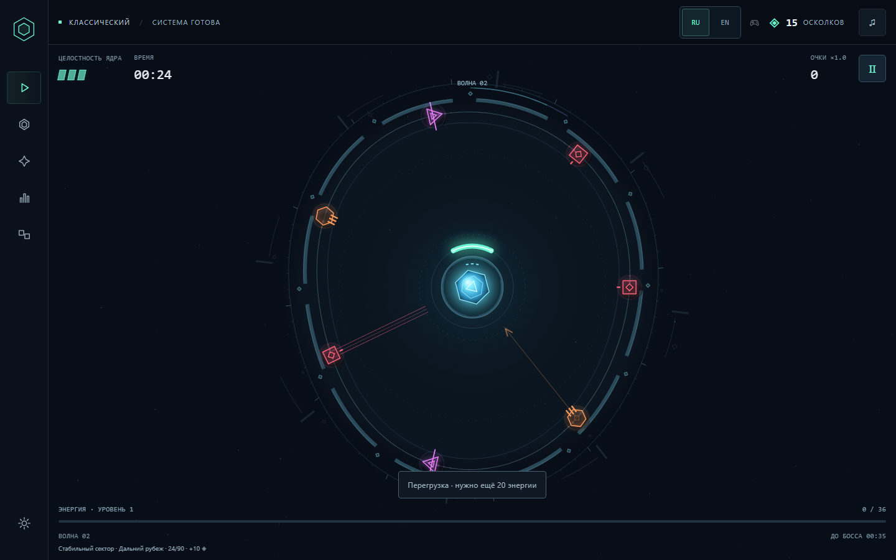

# CORE — ЯДРО

Браузерная аркада о защите последнего реактора. Поворачивайте щит, отражайте атаки и собирайте собственную комбинацию технологий.

**[Играть на сайте](https://core-reactor.steadylemur35.chatgpt.site)** · **[Скачать файлы проекта](https://github.com/reptile1891/core-reactor/archive/refs/heads/main.zip)** · Правила версии **1.15**

Актуальные файлы находятся в этом репозитории. Размещённый сайт обновляется отдельно; совпадение его версии с последним коммитом не подтверждено.

Английский по умолчанию, русский по переключателю RU · мышь, клавиатура, касание и геймпад · работа без интернета после скачивания.



Язык выбирается кнопками EN / RU и сохраняется между запусками. Ранее сохранённый русский язык продолжает использоваться.

После поражения итоговый экран показывает противника и тип последнего удара. Если в момент попадания шёл бой с боссом, там же указана его фаза. Список активных временных технологий можно раскрыть под причиной поражения.

## Быстрый запуск

1. Скачайте проект по ссылке выше или через **Code → Download ZIP**.
2. Распакуйте архив.
3. Откройте **dist/CORE.html** и нажмите **«В бой»**.

Установка, сервер и подключение к интернету для локальной игры не нужны. В `CORE.html` уже собраны стили и код. Многофайловую версию можно открыть через `dist/index.html`, сохранив рядом остальные файлы из `dist`.

Для запуска звука нужен щелчок, касание или другое действие в браузере. На телефоне удобнее пользоваться размещённой версией.

## Что есть в игре

- **11 типов обычных врагов и 4 босса:** Страж, Гидра, Фантом и Сингулярность. У каждого босса свои атаки и фазы.
- **32 временные технологии**, **23 постоянные технологии**, **3 тактики попытки**, сочетания улучшений и специализации максимальных уровней.
- **Четыре режима:** классический, испытание, чистый навык без постоянных и престижных бонусов, престижное испытание «Горизонт».
- **Развилки после боссов:** стабильный сектор, перегрев или помехи. Выбор проходит с остановленным временем.
- **События между боссами:** перехват конвоя, охота на ремонтников и защита сектора.
- **Необязательный контракт** перед запуском и тренировка уже встреченных боссов — полный бой или отдельная фаза.
- **Экспедиция:** два круга обороны, восемь боёв с боссами. После второго круга можно завершить попытку или перейти в бесконечный режим.
- **40 достижений**, включая легендарные, отдельные рекорды режимов, история попыток и необязательный престиж.
- **Шесть процедурных электронных тем:** Pulse Circuit, Neon Run, Solar Drive, Glass Highway, Midnight Vector и Ion Horizon. Темп плавно растёт от 126 до 156 ударов в минуту за первые десять минут забега; добавляются ударные и яркость синтезаторов. Отдельная громкость музыки и эффектов.
- Автоматическое сохранение прогресса, экспорт и импорт JSON, уменьшение эффектов и пауза при потере фокуса.

## Нестабильность орбит

Со второй до десятой минуты игрового времени орбиты постепенно приобретают постоянные изгибы и полуперекрученные ленточные края — визуальное приближение к ленте Мёбиуса. Враги следуют общей геометрии. Эффект не зависит от здоровья, останавливается на паузе и становится менее заметным при уменьшенных эффектах. Геометрия ограничена прежним предельным отклонением в 54 единицы; правила фиксации атак сохранены.

## Неоновые противники и взрывы

Все 11 обычных типов получили разные угловатые корпуса, внутренние световые дорожки и яркие контуры в духе «Трона». Взрывы дополнены геометрическими осколками и расходящимися дугами; цвет осколков соответствует врагу, уничтожение босса даёт более крупный эффект. В режиме уменьшенных эффектов осколки и дополнительное свечение отключены.

## Уведомления о выполнении целей

Выполненные задания событий отмечаются яркой бирюзовой карточкой с названием и звуковым сигналом; выполненный контракт — золотой карточкой с наградой по итогам попытки. Уведомления идут по очереди, не перехватывают управление, приостанавливаются вместе с боем и очищаются при новом запуске или выходе в меню. Уменьшенные эффекты отключают анимацию появления и свечение. Громкость сигнала зависит от настройки эффектов.

## Неоновые игровые события

Новый уровень отмечен крупным номером и последовательным появлением карточек. Специализация, выбор маршрута после босса и завершение экспедиции получили неоновые рамки, эмблемы и голубые, розовые и золотые акценты. Установка технологии и синергия сопровождаются отдельными уведомлениями, процедурными звуками и импульсом вокруг ядра. Рекорды и полученные достижения, включая легендарные, выделены карточками на экране результата. Уменьшенные эффекты отключают новые анимации и дополнительное свечение.

## Понятные описания улучшений

Описания редкости объясняют, что ценные технологии предлагаются чаще, без технического термина «вес» и процентов, которые можно принять за точную вероятность. Уточнены описания ремонта, защитного барьера, спасения от смертельного попадания и целей событий на русском и английском. Численные правила игры не менялись.

## Музыкальные фразы и переходы

У каждой из шести тем свой ведущий мотив, ритм баса, последовательность аккордов и сочетание синтезаторов. В бою на 7-м и 8-м тактах темы бас и основные ударные уступают место более тихому фрагменту, затем возвращаются. Последний такт постепенно затихает перед сменой темы; хвосты нот сокращаются, эхо приглушается. Длительность эха плавно следует за текущим темпом. Ведущая мелодия одна, арпеджио звучит тише.

## Видимая сборка в бою

Вместо кнопки с числом технологий отображается компактная панель: значки, уровни и цвета редкости. Полностью развитые технологии выделены рамкой, выбранная специализация отмечена звездой. Турель, спутник, корона и перехватчик показывают заряд по реальным таймерам; подавленная автоматика перечёркнута. На компьютере видно до 8 технологий, на узком или невысоком экране — до 4; остальные обозначены счётчиком. Нажатие, касание или Enter на панели открывают полный список на паузе. С геймпадом подробности доступны через Start.

## Понятный выбор технологий

Все 32 технологии получили короткое описание пользы. Карточки различают новую способность, усиление уже выбранной технологии и открытие сочетания. Для ключевых характеристик показан прогноз «было → станет» с учётом текущего ядра и ограничений; для остальных — изменение уровня и полное описание эффекта. Доступная на следующем уровне специализация отмечена отдельно. Полные правила действия всегда видны, уровни показаны сегментами. Прогноз не меняет состояние забега и не расходует случайные числа.

## Завершение обновления интерфейса

- **Характер сборки:** разряды, взрывы, защита и автоматика получают разные цветовые акценты панели энергии и сборки, а также небольшие геометрические элементы вокруг ядра. Направление определяется по выбранным технологиям. Цвета опасных атак сохранены.
- **Боссы:** здоровье разделено по порогам фаз, текущая фаза выделена. Открытая броня отмечена отдельным состоянием. При появлении босса показывается краткая особенность его атак.
- **Результат:** главное достижение попытки показано крупно — рекорд, победы над боссами, серия или достигнутая волна. Отдельно видны изменение осколков и исход контракта. Повторная игра остаётся доступной при прокрутке. Подробности и повтор попадания сохранены.
- **Развитие:** добавлены направления «Выживаемость», «Отражения» и «Энергия». Можно закрепить желаемую технологию, видеть недостающие осколки или требования и перейти прямо к ней. Закреплённая цель хранится отдельно в этом браузере и не входит в экспорт игрового сохранения.
- **Телефон:** карточки технологий перелистываются горизонтально; виден край следующей карточки. Перегрузка расположена справа в нижней части экрана, для горизонтального положения есть отдельная компоновка.
- **Уведомления:** сообщения различаются символами, цветом и звуком. Повторы объединяются, устаревшие сообщения убираются, важные показываются раньше. Во время появления босса и открытой брони уведомления ждут; обычные сообщения не конкурируют с главным окном.

## Главное меню «ИСТОК»

Меню оформлено как защитный интеллект реактора: собственная световая линза с геометрическими контурами, холодная типографика, голубой основной свет и сдержанный красный акцент. Конфигурация ядра влияет на цвет и геометрию линзы. Боевые враги и траектории убраны из фонового изображения главного меню. Настройки ядра и контракта раскрываются отдельными блоками и остаются открытыми при выборе. Режим, личный рекорд, испытание дня и закреплённая цель исследования сохранены. На телефоне есть отдельная компоновка; в горизонтальном положении кнопка запуска остаётся в первом экране. Уменьшенные эффекты останавливают движение новой линзы. Новых сетевых запросов и внешних ресурсов нет.

## Последние улучшения

### Интерфейс для коротких игровых сессий

- В главном меню — быстрый запуск, выбранное ядро и личный рекорд. Оформление ядра реагирует на конфигурацию.
- Основные разделы: «Играть», «Развитие» и «Коллекция». В коллекции находятся достижения, рекорды и конфигурации ядер. Режимы выбираются через кнопку «Сменить» перед запуском, настройки открываются отдельно.
- В бою панель навигации скрыта; кнопка «Сборка» открывает паузу с подробностями. Перегрузка показывает готовность и нехватку энергии.
- После попытки сразу доступны повторный запуск, итог изменения осколков и сохранение PNG-карточки результата. Подробная статистика и повтор попадания раскрываются отдельно.
- Подсказка следующего доступного исследования показывает, сколько осколков осталось накопить. Сочетающиеся улучшения отмечены при выборе, легендарные карты имеют отдельное оформление с учётом уменьшенных эффектов.

### Испытание дня

Один сценарий на дату UTC: базовое ядро, 3 HP, без постоянных бонусов и контрактов. Генератор событий получает общее зерно; дальнейший бой зависит от действий и выбора технологий. День меняется в 00:00 UTC по часам устройства. Повторить испытание можно несколько раз.

Ежедневный результат хранится отдельно от обычных рекордов; осколки, достижения и обычная статистика за испытание не начисляются. Сохраняются результаты последних семи дат. Сравнение локальное, общей сетевой таблицы нет. Формат сохранения остаётся 4, прежние данные поддерживаются. Карточку результата можно сохранить как PNG и отправить самостоятельно.

### Новые технологии · правила 1.13

Добавлены восемь технологий: накопитель, заряженное отражение, изоляция, ударный импульс, разрушитель брони, боевой ритм, самовосстановление и перехватчик. Вероятность развития уже выбранной технологии повышена на 35%, открытия нового сочетания — на 50%; это веса выбора, а не гарантированная выдача. Исправлен неполный выбор при малом количестве доступных карт.


### Достижения

В архиве 40 достижений за отражения, победы, время, серии и развитие реактора. Легендарные отмечены золотым и дают более крупную награду. Прежние достижения сохраняются; ранее выполненные новые цели начислятся при следующем завершении попытки или покупке технологии.


### Нарастание угрозы · правила 1.12

Со временем орбиты сильнее искривляются, а враги движутся быстрее. Музыка постепенно становится напряжённее. Перед появлением босса его будущую позицию отмечает пульсирующий сигнал, затем босс проявляется на орбите. Рекорды прежних правил сохраняются в архиве.

### Контракты

Перед запуском можно принять контракт или выбрать обычную попытку. Выполните условие и получите осколки. Провал или досрочное завершение попытки обойдётся в указанную сумму. Штраф не может увести баланс ниже нуля.

### Связанные исследования · правила 1.11

В «Эволюции ядра» появилась вкладка **«Связи»**. Три новых исследования открываются после покупки двух базовых технологий: усиление ширины щита, дополнительная энергия за идеальное отражение и снижение стоимости Перегрузки. Условия видны прямо на карточках; покупка недоступна, пока они не выполнены. Эти бонусы, как и другие постоянные технологии, отключены в «Чистом навыке» и тренировке боссов.

Старые покупки, валюта и достижения сохраняются. Результаты правил 1.10 остаются в архиве, новые рекорды ведутся отдельно для правил 1.11. Формат сохранения остаётся 4.

### Три тактики попытки · правила 1.10

На третьем уровне вместо обычной технологии выберите одну тактику до конца попытки. Время выбора остановлено; работают кнопки, касание, клавиши 1/2/3 и геймпад. Это отдельный выбор: заменить варианты нельзя, заряды замены не тратятся.

| Тактика | Преимущество | Ограничение |
| --- | --- | --- |
| Точный импульс | Урон идеальных отражений и их эха +35% | Обычные отражения и их эхо наносят на 15% меньше урона |
| Залповая Перегрузка | При Перегрузке до трёх разных целей получают самонаводящиеся снаряды с уроном 1,2 | Базовая стоимость 30 энергии, перезарядка 10 с; эти снаряды не запускают цепь и взрывы |
| Манёвровый контур | Скорость щита +15%; блок при повороте быстрее 90°/с даёт барьер на 0,25 с, не чаще раза в 3 с | Щит уже на 8° |

Тактика показана на паузе, в итогах и истории новых попыток. Тренировка боссов сохраняет базовые правила без тактик. Сочетайте точность с критами и барьером, залп — с набором энергии, манёвры — со скоростью и шириной щита.

Рекорды правил 1.10 доступны в архиве; всеобщие рекорды, осколки, покупки, достижения и настройки сохраняются.

### Живая арена

Сегменты орбит вращаются. Каждые 48 секунд контуры плавно меняют форму и возвращаются к кругу; враги движутся по этим же контурам. Обычные враги медленно движутся с начала попытки, затем разгоняются после 18 секунд. На паузе движение остановлено.

Враги и снаряды стали заметнее, отражения получили дополнительные эффекты. Подписи «СНАРЯД», «ЛАЗЕР» и «СПИРАЛЬ» убраны: направление атаки обозначают линии и указатели. Безопасный ложный луч Фантома сохраняет пунктир и метку **«ЭХО»**.

### Более удобный интерфейс

- На телефоне реактор в главном меню расположен отдельно от кнопки запуска; у навигации появились подписи.
- Выбранные ядро и контракт выделены, награда за цель видна сразу. Выбор сохраняет прокрутку и фокус.
- Перегрузка показывает готовность, нехватку энергии или оставшееся время перезарядки.
- На паузе видны здоровье, время, очки и описания взятых технологий.
- Карточки выровнены на компьютере и компактнее на телефоне. Показаны сочетания технологий, а для ширины щита, урона отражений и ремонта — значения до и после выбора.
- Появление боссов и смена фаз отмечаются отдельными сообщениями; после победы показано полученное усиление.

### Итоги попытки и цели событий

В итогах появились главный результат, основной источник урона и совет на следующую попытку. Повтор последнего попадания показывает место удара и положение щита.

У событий есть необязательные цели:

| Событие | Цель |
| --- | --- |
| Перехват конвоя | Уничтожить две отмеченные цели |
| Охота на ремонтников | Уничтожить отмеченного ремонтника |
| Защита сектора | Отразить пять атак без потери HP |

На экране видны условие, прогресс и оставшееся время. Цели отмечены золотым контуром. Дополнительных наград и штрафов за выполнение целей нет; обычные награды боя сохраняются.

Источники урона учитываются по группам: отражения, цепь, взрывы и автоматика. Это не точная статистика каждой отдельной технологии.

## Управление

| Действие | Мышь / клавиатура / касание | Стандартный геймпад |
| --- | --- | --- |
| Направление щита | Курсор или касание; A/D, Ф/В, стрелки влево/вправо | Любой стик, крестовина; LB/RB для вращения |
| Перегрузка | E / У, правая кнопка мыши или кнопка на экране | A / ✕, X / □ или RT / R2 |
| Пауза / продолжение | Пробел, Esc или кнопка паузы | Start / Options |
| Выбор технологии / маршрута | Щелчок, касание или 1/2/3 | Направление и A / ✕ |
| Выбор специализации | Щелчок, касание или 1/2 | Направление и A / ✕ |
| Запуск / новая попытка | Enter или кнопка на экране | Выбрать кнопку и нажать A / ✕ |
| Назад | Кнопки интерфейса, Esc по ситуации | B / ○; во время боя сначала пауза |

Нажмите кнопку подключённого геймпада, чтобы браузер его обнаружил. Поддержка зависит от устройства, ОС и браузера. При отключении используемого контроллера игра ставится на паузу. Мёртвая зона стиков настраивается от 10% до 40%.

## Как устроен бой

Базовый щит: дуга **55°**, скорость поворота **540°/с**, радиус **65**, здоровье **3 HP**. Щит поворачивается с ограниченной скоростью. Подставьте движущийся щит под траекторию за **120 мс** до столкновения для идеального отражения; удержание в одном направлении не обновляет это окно.

Прицел следует за врагом во время подготовки, затем фиксируется минимум за **0,5 с** до выстрела. После фиксации направление и точка запуска сохраняются, даже если враг продолжает движение. Выпущенные снаряды не следуют за врагом.

Обычная Перегрузка стоит **20 энергии**, перезаряжается **8 с** (тактика залпа меняет эти значения на 30 энергии и 10 с) и очищает снаряды в радиусе **140**. Она не лечит ядро и не блокирует лазеры. После потери HP действует **0,7 с** неуязвимости.

Постоянное развитие ограничено 5 HP и дополнительными 12° основной дуги; временная ширина ограничена 105°. Награда Стража может поднять максимум здоровья текущей попытки до 6 HP. Боссы получают 65% урона под бронёй и 145% в уязвимости.

Осколки за бой начисляются после 8 секунд. Итог одной попытки нельзя получить повторно. Тренировка не приносит осколков, достижений и рекордов.

## Сохранения

Прогресс хранится в `localStorage` браузера. Текущий формат — **4**, поддерживается импорт форматов 1/2/3. Язык и настройки управления входят в сохранение.

В настройках доступны экспорт и импорт JSON. Перед импортом и подтверждённым сбросом создаётся резервная копия. Повреждённый исходный JSON можно скачать; игра не должна перезаписывать его автоматически. Если браузер запретил хранилище, игра продолжает работу в памяти и показывает предупреждение.

**Сайт, локальный HTML и разные браузеры используют разные хранилища.** Для переноса прогресса экспортируйте JSON и импортируйте его в новом месте. Перед очисткой браузера рекомендуется сделать экспорт.

Это локальная игра: онлайн-таблиц и серверной защиты результатов нет.

## Проверки и ограничения

Проверки логики запускаются в Node.js без установки пакетов:

```sh
node tests/run.cjs
node tests/aim.cjs
node tests/orbits.cjs
node tests/event-objectives.cjs
node tests/tactics.cjs
node tests/tactics-balance.cjs
node tests/audit-fixes.cjs
node tests/gamepad.cjs
node tests/expansion.cjs
node tests/expedition.cjs
```

Дополнительные проверки аудио и симуляций: `tests/audio.cjs`, `tests/audio-context.cjs`, `tests/simulate.cjs`, `tests/features.cjs`. Отдельный стенд `tests/ui-runtime.cjs` требует установленный `@napi-rs/canvas`; самой игре этот пакет не нужен.

Интерфейс проверен в настоящем Chrome в фоновом режиме: просмотрены снимки основных экранов, боя и боссов при **1440×900**, **390×844** и **844×390**, включая русский/английский и уменьшенные эффекты. Для воспроизводимых экранов использованы подготовленные состояния игры.

Реальные касания, физические геймпады, слышимое аудио и стабильные 60 FPS на реальных телефонах не проверены. Автоматические симуляции не заменяют проверку интереса и сложности живыми игроками.

Подробности — в [TEST-REPORT.md](TEST-REPORT.md). [Скриншоты проверок](https://github.com/reptile1891/core-reactor/tree/main/tools/visual-check).

## Файлы проекта

| Файл | Назначение |
| --- | --- |
| `dist/CORE.html` | Автономная игра одним файлом |
| `dist/CORE-offline.zip` | Архив игры для скачивания |
| `dist/index.html`, `dist/style.css` | Интерфейс и оформление |
| `dist/data.js` | Противники, технологии, цены и параметры |
| `dist/engine.js` | Симуляция боя и сохранения |
| `dist/game.js` | Управление, интерфейс и отрисовка |
| `dist/i18n.js` | Русский и английский интерфейс |
| `dist/audio.js`, `dist/gamepad.js` | Звук и контроллеры |
| `tests/` | Автоматические проверки |
| `tools/package.py` | Сборка автономного HTML и ZIP |

Игра использует HTML, CSS, JavaScript, Canvas 2D и Web Audio API. Внешних библиотек, CDN и игровых сетевых запросов нет.

## Неоновое меню
Главное меню оформлено как пульт станции: голубые световые контуры, янтарная дымка, процедурный силуэт города и проекция реактора. Запуск расположен в основном блоке, ядро и контракт — в отдельных панелях подготовки. Обновлены магазин, режимы, настройки и навигация. На телефоне компоновка одноколоночная; при небольшой высоте окна скрывается необязательный вводный текст. Декоративные дождевые штрихи и окна города отключаются настройкой уменьшения эффектов. Оформление не требует загрузки изображений или шрифтов.

## Неоновый бой
Ядро и враги получили усиленное свечение, снаряды — яркие следы. Взрывы сопровождаются янтарной вспышкой, голубой ударной волной и искрами. На телефоне число новых искр уменьшено; настройка уменьшенных эффектов отключает новые вспышки и декоративные дуги. Эти изменения затрагивают отрисовку, без изменения урона и наград.

### Встраивание в Pixo

При запуске во фрейме игра отправляет родительскому окну сообщения `run-start` и `run-end` через `postMessage`. Таблица задаётся текущим `mode`; итог содержит очки, волну, число боссов и врагов. Отправка итога выполняется только после успешного однократного расчёта. При отдельном запуске и тренировке боссов сообщений нет. Получатель ограничен `location.origin`: родитель должен иметь тот же origin, что и игра. Проверка приёма и публикации результата на самом Pixo отдельно не проводилась.

В бою ядро также имеет вращающиеся объёмные грани, встречные световые дуги и расходящийся импульс внутри защитного щита. Эффекты используют время симуляции и останавливаются на паузе; уменьшенные эффекты и системное ограничение движения оставляют статичное ядро. Геометрия щита и столкновений сохранена.

## Живая геометрия противников

Все 11 типов сохраняют неоновые геометрические силуэты, но получают внутренние вращающиеся грани и подвижные элементы. Орудия раскрываются в соответствии с настоящей подготовкой атаки и дают короткую отдачу после выстрела; у дробовика стволы расходятся веером, у снайпера выдвигаются, у ремонтника вращаются малые сегменты. Попадание вызывает короткую световую волну, при низком здоровье видны трещины. Обломки используют контуры корпусов. У четырёх боссов добавлены вращающиеся дуги и сегменты, при открытой броне видно внутреннее ядро. Анимация использует время симуляции, замирает на паузе и упрощается при уменьшенных эффектах или системном ограничении движения. Урон, траектории, предупреждения и баланс не менялись.

## Визуальная эволюция ядра

В каждом забеге ядро постепенно усложняется. Главные ступени связаны с числом побеждённых боссов; время забега добавляет небольшое промежуточное развитие. Начальный многогранник получает новые грани, затем появляются до трёх встречных оболочек и небольшие подвижные сегменты. К концу второго круга форма становится наиболее сложной; в бесконечном режиме сегменты плавно расходятся и собираются. Смена формы после босса занимает несколько секунд игрового времени. Новые элементы находятся внутри радиуса 45 при радиусе щита 65. Новый забег начинает эволюцию заново; тренировка использует начальную форму. Уменьшенные эффекты и системное ограничение движения сохраняют соответствующую глубине форму без вращения и плавных перестроек. Это только внешний вид: здоровье, урон, награды и сохранения не меняются.

У противников нет глаз и светящихся зрачков: внутренние узлы выполнены как многогранники и линии схем. Световые точки на оружии заменены короткими контактами. Геометрическая анимация и предупреждения об атаках сохранены.

## Характер боя и история попытки

Идеальные отражения дают направленные искры и короткую волну по щиту; насыщенность ограниченно растёт с идеальной серией. Звуковой акцент также усиливается в пределах фиксированной громкости. Разрядная, взрывная, защитная и автоматическая сборки получили собственные детали следов дружественных снарядов.

После боссов меняются оттенок фона, внешние геометрические контуры и тихий музыкальный акцент: внешний контур, энергетический узел, глубинный архив, сердце системы. Эти визуальные этапы не заменяют существующий выбор маршрута. У боссов добавлена плавная перестройка дуг и внутренних сегментов при смене фазы; реальные атаки и их предупреждения сохраняют прежнее расписание.

На экране обычной попытки появилась сигнатура забега: снимок финального ядра, ведущая сборка, до трёх технологий и до трёх фактов о результате. Они берутся из фактических данных текущего забега. Для повторного просмотра используется тот же снимок; история старых сохранений не дополняется задним числом. Ежедневный режим и тренировка сохраняют свои отдельные результаты. Уменьшенные эффекты отключают дополнительные частицы и следы, перестройка фаз становится мгновенной.


## Расширенная экспедиция · правила 1.14

Основной забег теперь включает восемь боёв: четыре знакомых босса и второй круг с усиленными версиями тех же противников (здоровье +35%). Новых типов боссов не добавлено. Первый босс появляется на 60-й секунде, следующие — не чаще раза в минуту и минимум через 20 секунд после предыдущей победы. Финал возможен не раньше восьмой минуты игрового времени; затяжные бои увеличивают длительность. Время на экранах выбора не учитывается. Между боссами продолжаются события, развитие сборки и выбор маршрута. После четвёртой победы появляется сообщение о втором круге, в бою виден прогресс из восьми побед. Эволюция ядра и оформление секторов растянуты на всю экспедицию.

Ежедневный режим сохраняет финал после четырёх боссов, тренировка не меняется. Завершить обычную попытку раньше можно через паузу с обычным расчётом наград и штрафа контракта. Валюта, технологии и достижения сохраняются. Старые результаты отделяются в архив правил 1.13; новые рекорды считаются для 1.14.


## Второй круг и финал · правила 1.15

Второй круг теперь отличается атаками. Страж чередует перекрёстный лазер и ответный залп, Гидра переставляет секции и сочетает веер с изогнутым выстрелом, Фантом отвлекает пунктирным эхом перед настоящей атакой с другой стороны. Все приёмы используют общую очередь предупреждений, ограничение числа атак и минимум полсекунды после фиксации прицела.

Восьмой бой — Сингулярность «Сердце системы». Вступление занимает 3,5 с без урона боссу. Три оболочки меняют приёмы: изогнутые выстрелы, подключение лазера, затем последовательность с веером. На порогах 67% и 34% здоровья оболочка перестраивается за 1,3 с. Один мощный удар не пропускает этап; незапущенные предупреждения отменяются, уже выпущенные атаки сохраняются. После победы показано геометрическое разрушение перед итоговым окном. При уменьшенных эффектах окно открывается сразу.

После босса доступны пять маршрутов. Стабильный сектор восстанавливает 1 здоровье при входе. Перегрев и помехи сохраняют прежние условия. Новый сектор точности ускоряет снаряды на 10% и даёт 5 дополнительной энергии за идеальное отражение. Подвижный фронт смещает прицел одиночных орудий в стороны и даёт 3 энергии за блок при повороте щита быстрее 90°/с. Дополнительная энергия выдаётся один раз за атаку, включая залпы. Выбор доступен кнопками 1–5, мышью, касанием и геймпадом; на телефоне карточки листаются.

Три завершённых сочетания технологий действуют до конца забега:

- Грозовая сеть: Дуговой разряд 2 и Критическая масса. Ещё одна цель цепи с 65% обычного урона разряда; исходные разряды не ослаблены.
- Взрывной каскад: Нестабильная материя 2 и Фазовый пробой. Радиус каждого взрыва увеличен на 12 единиц.
- Зеркальная крепость: Зеркальный барьер 2 и Резонанс серии. Каждое третье идеальное отражение подряд продлевает барьер ещё на 0,35 с.

Карточки выбора заранее показывают завершение сборки. Активные сочетания видны на паузе и в результате, при получении появляется уведомление. Это дополнительные эффекты существующих 32 технологий. Новых типов боссов и формата сохранений нет. В ежедневном испытании остаются прежние три маршрута без нового лечения, четыре базовых босса и прежние сочетания без завершающих бонусов, чтобы не менять сценарий дня. Прогресс сохраняется; рекорды обычных режимов отделены по правилам 1.15.
